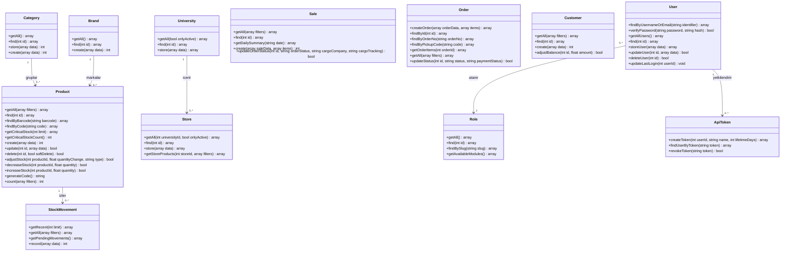

# 📋 CampusStock — Gereksinim Analizi & Vize Sunum Dokümanı

> Bu doküman, **İnternet Programlama** dersi `Vize Uygulama.pdf` (16 slaytlık yapı) ve `Proje değerlendirme ölçütleri (1).pdf` (100 puanlık rubrik) esas alınarak hazırlanmıştır.

---

## 1. Proje Ekibi & GitHub Adresi
* **Depo Sahibi & Tasarım:** Fatih Özer (`fatihozr`)
* **Geliştirme & Backend / Mimari:** Ahmet Burak İşleyen (`zeldasprt`)
* **GitHub Deposu:** https://github.com/fatihozr/CampusStock
* **Aktif Geliştirme Dalı & PR:** `feature/stok-satis-sistemi` ([Pull Request #1](https://github.com/fatihozr/CampusStock/pull/1))

---

## 2. Proje Adı, Amacı ve Özeti
* **Proje Adı:** **CampusStock** — Üniversiteye Özel Kırtasiye Sipariş ve Stok Yönetim Platformu
* **Projenin Amacı:** Üniversite öğrencilerinin yalnızca kendi üniversitelerindeki kampüs kırtasiyelerinden ürün seçip sipariş verebilmesini, kırtasiye yöneticilerinin ise barkodlu hızlı satış (POS), stok takibi, kategori/marka yönetimi, sipariş durumu ve iade süreçlerini tek bir web yönetim panelinden hatasız yönetebilmesini sağlamak.
* **Proje Özeti:** PHP 8.2+ (MVC & RESTful API) tabanlı, çift yönlendiricili (`routes/web.php` + GitHub `config/routes.php`), session tabanlı kalıcı MOCK veri ve MySQL/SQLite hibrit altyapısına sahip, Bootstrap 5.3 + Vanilla JS arayüzlü tam kapsamlı bir kırtasiye yönetim platformudur.

---

## 3. Kullanılan Teknolojiler
* **Backend:** PHP 8.2+, PSR-4 Autoloading, MVC + Service Layer (`PosService`, `OrderService`, `MockDataService`)
* **Frontend:** HTML5 (Semantik + WCAG 2.2 AA), CSS3 (Özel Tasarım Sistemi + Dark/Light Tema + `prefers-reduced-motion`), Vanilla JavaScript (`Fetch API`, `SweetAlert2`, `Chart.js`, `TomSelect`, `QRCode.js`), Bootstrap 5.3
* **Veritabanı Tasarımı:** `CampusStockDb.drawio` ER Diyagramı (MySQL / SQLite şemaları + aktif geliştirme için `MockDataService`)
* **Güvenlik:** `bcrypt` (`password_hash`/`password_verify`), CSRF Token (`App\Helpers\Csrf`), XSS koruması (`htmlspecialchars`), HttpOnly/SameSite çerezler, OWASP HTTP başlıkları, Bearer Token API kimlik doğrulama

---

## 4. Veriye Dayalı Gereksinimler (10 Adet)
1. **Üniversite Verisi:** `id`, `ad`, `il`, `adres`, `telefon` bilgileri tutulmalıdır.
2. **Kırtasiye Şube Verisi:** `id`, `universite_id`, `ad`, `adres`, `telefon`, `vergi_no`, `calisma_saatleri` kaydedilmelidir.
3. **Kullanıcı & Yönetici Verisi:** `id`, `ad`, `soyad`, `email`, `sifre (hash)`, `telefon`, `rol` ve adres alt alanları (`il`, `ilce`, `sokak`, `mahalle`, `zip_code`) saklanmalıdır.
4. **Kategori Verisi:** Kırtasiye ürünlerini gruplamak için `id`, `ad` ve ürün sayısı tutulmalıdır.
5. **Ürün & Stok Verisi:** `id`, `kategori_id`, `ad`, `barkod`, `fiyat`, `stok`, `min_stok`, `raf_konumu`, `gorsel_url` bilgileri saklanmalıdır.
6. **Stok Hareket Verisi:** Her giriş/çıkış/satış/iade için `tarih`, `miktar`, `hareket_tipi`, `prev_stock`, `next_stock`, `aciklama` kayıtları tutulmalıdır.
7. **Sepet Verisi:** `id`, `kullanici_id`, `toplam_tutar`, `olusturma_tarihi` ve sepetteki ürün adetleri saklanmalıdır.
8. **Sipariş & Sipariş Detayı Verisi:** `id`, `siparis_no`, `kullanici_id`, `kirtasiye_id`, `durum`, `toplam_tutar`, ürün kalemleri, `puan` ve `yorum` tutulmalıdır.
9. **Ödeme & Kargo Verisi:** `odeme_yontemi`, `odeme_durumu`, `kargo_firmasi`, `takip_no`, `kargo_ucreti` takip edilmelidir.
10. **İade Verisi:** `id`, `siparis_id`, `neden`, `tarih`, `durum`, `iade_tutari` kayıt altına alınmalıdır.

---

## 5. İşleve Dayalı Gereksinimler (10 Adet)
1. Kullanıcılar güvenli giriş/çıkış yapabilmeli ve rolüne göre yetkilendirilmelidir.
2. Yöneticiler yeni kırtasiye ürünü ekleyebilmeli, güncelleyebilmeli ve silebilmelidir (CRUD).
3. Barkod okuyucu veya arama kutusu ile ürün saniyeler içinde bulunabilmelidir.
4. Kritik stok seviyesinin altına düşen ürünler sistem tarafından otomatik işaretlenip bildirim üretmelidir.
5. Hızlı Satış (POS) ekranında sepet tutarı, KDV ve müşteri iskontosu anlık hesaplanmalıdır.
6. Satış tamamlandığında ürün stoğu atomik olarak düşmeli ve stok hareketi kaydedilmelidir.
7. İade talebi oluşturulduğunda ürün stoğu geri yüklenmeli ve iade durumu güncellenebilmelidir.
8. Üniversite ve kampüs kırtasiye şubeleri yönetim panelinden eklenip listelenebilmelidir.
9. Üye ve müşteri kayıtları adres detaylarıyla (il, ilçe, mahalle, sokak, zip) yönetilebilmelidir.
10. Harici frontend/mobil istemciler için RESTful JSON API (`GET`, `POST`, `PUT`, `DELETE`) ve CORS desteği sunulmalıdır.

---

## 6. Örnek Fonksiyonlar (5 Adet)
1. `PosService::calculateCart()` — Sepetteki ürünlerin birim fiyat, KDV oranı ve müşteri indirimine göre net toplamını hesaplar.
2. `PosService::checkout()` — Satışı tamamlar, fiş numarası üretir ve stoktan düşüm yaparak hareket kaydı açar.
3. `PosService::processReturn()` — Satış kaleminden iade alır, iade kaydı oluşturur ve stoğu otomatik artırır.
4. `Product::adjustStock()` — Ürün stoğunu artırır/azaltır ve `StockMovement` denetim kaydını oluşturur.
5. `Auth::hasPermission()` / `Csrf::verify()` — Kullanıcının rol yetkisini ve form güvenliğini doğrular.

---

## 7. Örnek Kullanıcı Senaryoları (5 Adet)
1. **Kasiyer POS Satışı:** Kasiyer `/pos` ekranında barkod okutur, nakit/kart seçip satışı onaylar; fiş oluşur ve stok azalır.
2. **Kritik Stok Uyarısı & Girişi:** Yönetici üst bardaki bildirim zilinde kritik stok uyarısını görür, `/products?tab=critical` sayfasına gider ve "Stok Girişi" modalından stok ekler.
3. **Müşteri İadesi:** Satış detayından (`/sales/detail?id=1`) iade işlemi başlatılır; `/returns` sayfasından iade durumu `Onaylandı` olarak güncellenir ve ürün stoğa geri döner.
4. **Kampüs Şubesi Ekleme:** Genel Admin `/stores` sayfasından yeni üniversite ve kırtasiye şubesi tanımlar.
5. **Harici Frontend API Girişi:** React/mobil istemci `POST /api/v1/auth/login` ile Bearer token alır ve `GET /api/v1/stores/1/products` ile ürünleri çeker.

---

## 8. Kullanıcı Rolleri ve Yetkiler
* **Genel Admin (`admin`):** Tüm üniversiteler, kırtasiyeler, kullanıcılar, roller, raporlar ve stok işlemleri üzerinde tam yetki.
* **Kırtasiye Yöneticisi (`kadmin`):** Bağlı olduğu kırtasiyenin ürünlerini, stok giriş/çıkışlarını, POS satışlarını, siparişlerini ve iadelerini yönetir.
* **Üye / Öğrenci (`uye`):** Kendi üniversitesindeki kırtasiyeleri görüntüler, sepet oluşturur, sipariş verir ve iade/değerlendirme yapar.

---

## 9. İstemci Mimarisi, Backend İletişimi ve Doğrulama
* **Routing:** Web ve `/api/v1/*` rotaları `app/Config/Router.php` (`routes/web.php`), GitHub çekirdek rotaları `app/Core/Router.php` (`config/routes.php`) üzerinden yönetilir.
* **Backend İletişimi:** İstemci `fetch()` ile JSON gönderir; sunucu standart HTTP durum kodları (`200`, `201`, `400`, `401`, `404`, `405`, `422`) ve UTF-8 JSON yanıtı döner.
* **Doğrulama:** İstemci tarafında HTML5 + Bootstrap `.needs-validation`, sunucu tarafında ise CSRF token, zorunlu alan kontrolü, sayısal sınır ve tip doğrulaması yapılır.

---

## 10. Backend UML Sınıf ve Fonksiyon Diyagramı

Aşağıdaki UML sınıf diyagramı, CampusStock backend mimarisindeki tüm katmanları (**Core/Config/Helpers**, **Services**, **Models** ve **Controllers**) ve bu sınıfların gerçek fonksiyon imzalarını göstermektedir.

### 10.1 Çekirdek Altyapı, Güvenlik & Servis Katmanı (Core, Helpers, Services)

```mermaid
classDiagram
    class App {
        -array config
        +init() void
        +get(string key, mixed default) mixed
        -loadEnv() void
    }

    class Database {
        -PDO instance
        +getConnection() PDO
    }

    class ConfigRouter {
        -array routes
        +get(string path, callable handler) void
        +post(string path, callable handler) void
        +put(string path, callable handler) void
        +delete(string path, callable handler) void
        +options(string path, callable handler) void
        +dispatch() void
    }

    class CoreRouter {
        -array rotalar
        +get(string yol, array hedef, array araKatmanlar) void
        +post(string yol, array hedef, array araKatmanlar) void
        +put(string yol, array hedef, array araKatmanlar) void
        +delete(string yol, array hedef, array araKatmanlar) void
        +eslestir(string metot, string yol) array
        +calistir(Request istek) void
    }

    class Request {
        +string metot
        +string yol
        +bool govdeHatali
        +yakala() Request
        +sorgu(string ad, mixed varsayilan) mixed
        +girdi(string ad, mixed varsayilan) mixed
        +tumGirdi() array
        +baslik(string ad) string
        +parametre(string ad) mixed
        +apiMi() bool
    }

    class Response {
        +json(mixed veri, int kod) never
        +hata(string mesaj, int kod, array ek) never
        +bos(int kod) never
    }

    class Auth {
        +init() void
        +check() bool
        +user() array
        +login(array user, bool remember) void
        +logout() void
        +requireAuth() void
        +requireGuest() void
        +hasPermission(string module) bool
        +isAdmin() bool
        +isManager() bool
        +hasRole(string roles) bool
        +requirePermission(string module) void
    }

    class Csrf {
        +token() string
        +field() string
        +verify(string token) bool
    }

    class MockDataService {
        +init() void
        +reset() void
        +all(string table) array
        +saveAll(string table, array rows) void
        +find(string table, int id) array
        +nextId(string table) int
    }

    class PosService {
        -Product productModel
        -Sale saleModel
        -Customer customerModel
        +calculateCart(array rawItems, int customerId, float customDiscountRate) array
        +checkout(array data, int userId) array
        +processReturn(int saleId, int saleItemId, float returnQuantity, string reason, int userId) array
    }

    class OrderService {
        -Order orderModel
        -Product productModel
        -StockMovement stockMovementModel
        +createOrder(int studentId, array data) array
        +verifyPickup(string code) array
        +deliverOrder(int orderId, string paymentMethod) array
        +cancelOrder(int orderId) array
    }

    PosService --> MockDataService : kullanir
    CoreRouter --> Request : yakalar
    CoreRouter --> Response : yanitlar
```

### 10.2 Veri Modelleri Katmanı (Models)

### 10.3 Denetleyici Katmanı (Web & Core REST API Controllers)

```mermaid
classDiagram
    class AuthController {
        +login() void
        +handleLogin() void
        +logout() void
    }

    class DashboardController {
        +index() void
        +globalSearch() void
    }

    class StockController {
        +index() void
        +create() void
        +store() void
        +detail() void
        +update() void
        +delete() void
        +stockIn() void
        +stockOut() void
        +movements() void
    }

    class PosController {
        +index() void
    }

    class SaleController {
        +index() void
        +detail() void
        +handleReturn() void
    }

    class ReturnWebController {
        +index() void
        +updateStatus() void
    }

    class StoreWebController {
        +index() void
        +storeUniversity() void
        +storeBranch() void
    }

    class CategoryController {
        +index() void
        +store() void
    }

    class BrandController {
        +index() void
        +store() void
    }

    class CustomerController {
        +index() void
        +store() void
        +handlePayment() void
    }

    class ReportController {
        +index() void
        +export() void
        +pdf() void
    }

    class UserController {
        +index() void
        +storeUser() void
        +updateUser() void
        +deleteUser() void
    }

    class KimlikController {
        +giris(Request istek) void
        +kayit(Request istek) void
        +profil(Request istek) void
    }

    class UniversiteController {
        +liste(Request istek) void
        +detay(Request istek) void
        +kirtasiyeler(Request istek) void
    }

    class KirtasiyeController {
        +liste(Request istek) void
        +detay(Request istek) void
        +urunler(Request istek) void
    }

    class UrunController {
        +liste(Request istek) void
        +detay(Request istek) void
        +barkod(Request istek) void
    }

    class SepetController {
        +goster(Request istek) void
        +ekle(Request istek) void
        +sil(Request istek) void
    }

    class SiparisController {
        +olustur(Request istek) void
        +liste(Request istek) void
        +detay(Request istek) void
        +kodDogrula(Request istek) void
        +durumGuncelle(Request istek) void
    }

    class SaglikController {
        +goster(Request istek) void
    }
```

