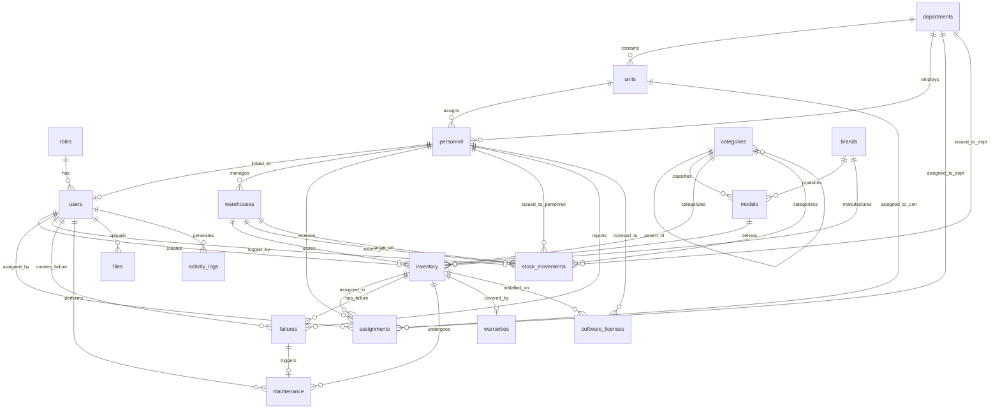

# T.C. BELEDİYE BAŞKANLIĞI
## BİLGİ İŞLEM MÜDÜRLÜĞÜ ENVANTER VE STOK TAKİP SİSTEMİ
### İLİŞKİSEL VERİTABANI VE ER (ENTITY RELATIONSHIP) TASARIM DOKÜMANI

---

## 1. GİRİŞ VE VERİTABANI MİMARİSİ

Bu doküman, Belediye Bilgi İşlem Müdürlüğü Envanter ve Stok Takip Sistemi için tasarlanmış MySQL / MariaDB uyumlu **İlişkisel Veritabanı (RDBMS)** mimarisini ve Varlık-İlişki (ER) yapısını açıklar.

- **Veritabanı Motoru:** MySQL 8.0+ / MariaDB (InnoDB Engine)
- **Karakter Seti:** `utf8mb4_unicode_ci` (Türkçe karakter ve emoji desteği)
- **İlişkisel Bütünlük:** Tüm yabancı anahtarlarda `FOREIGN KEY` kısıtlamaları ve silme/güncelleme kuralları (`ON DELETE RESTRICT/SET NULL/CASCADE`) tanımlanmıştır.

---

## 2. TABLO DETAYLARI VE İLİŞKİ HİYERARŞİSİ

Sistemde toplam **18 adet ilişkisel tablo** bulunmaktadır. Aşağıda her tablonun amacı, tutulan alanlar, birincil (PK) ve ikincil (FK) anahtarlar açıklanmıştır.

---

### 1. `roles` (Kullanıcı Rolleri ve Yetki Matrisi)
- **Amacı:** Sisteme giriş yapan kullanıcıların rol ve izinlerini tutar.
- **Birincil Anahtar (PK):** `id` (INT, AUTO_INCREMENT)
- **Yabancı Anahtarlar (FK):** Yok
- **Alanlar:**
  - `id` (PK)
  - `name`: Rol adı (*Örn: Sistem Yöneticisi, Depo Sorumlusu, Teknik Servis Elemanı*)
  - `slug`: Rol koda dönüştürülmüş adı (*admin, warehouse_manager, tech_support, read_only*)
  - `description`: Rol açıklaması
  - `permissions`: Rolün erişebileceği modül ve eylemler (JSON formatında)
  - `created_at`, `updated_at`

---

### 2. `departments` (Müdürlükler)
- **Amacı:** Belediyeye ait ana müdürlükleri tutar.
- **Birincil Anahtar (PK):** `id` (INT, AUTO_INCREMENT)
- **Yabancı Anahtarlar (FK):** Yok
- **Alanlar:**
  - `id` (PK)
  - `name`: Müdürlük adı (*Örn: Bilgi İşlem Müdürlüğü, İmar ve Şehircilik Müdürlüğü*)
  - `code`: Kurum içi müdürlük kodu (*Örn: BIM, IMR, FEN*)
  - `phone`: Dahili / Telefon numarası
  - `email`: Müdürlük genel e-posta adresi
  - `status`: Durumu (*active, inactive*)
  - `created_at`, `updated_at`

---

### 3. `units` (Alt Birimler / Lokasyonlar)
- **Amacı:** Müdürlüklere bağlı alt birimleri veya fiziki lokasyonları tutar.
- **Birincil Anahtar (PK):** `id` (INT, AUTO_INCREMENT)
- **Yabancı Anahtarlar (FK):**
  - `department_id` ➔ `departments(id)` (ON DELETE RESTRICT)
- **Alanlar:**
  - `id` (PK)
  - `department_id` (FK)
  - `name`: Birim adı (*Örn: Yazılım Şefliği, Şantiye Binası Ofisi*)
  - `location_building`: Hizmet Binası adı (*Örn: Ana Hizmet Binası, Ek Hizmet Binası*)
  - `floor`: Kat numarası
  - `room_number`: Oda numarası
  - `created_at`, `updated_at`

---

### 4. `personnel` (Belediye Personelleri)
- **Amacı:** Belediyede çalışan tüm personelin kimlik ve görev bilgilerini tutar.
- **Birincil Anahtar (PK):** `id` (INT, AUTO_INCREMENT)
- **Yabancı Anahtarlar (FK):**
  - `department_id` ➔ `departments(id)` (ON DELETE RESTRICT)
  - `unit_id` ➔ `units(id)` (ON DELETE SET NULL)
- **Alanlar:**
  - `id` (PK)
  - `department_id` (FK)
  - `unit_id` (FK, Nullable)
  - `tc_no`: T.C. Kimlik Numarası (Unique)
  - `sicil_no`: Kurum Sicil Numarası (Unique)
  - `first_name`: Adı
  - `last_name`: Soyadı
  - `title`: Unvanı (*Örn: Bilgisayar Mühendisi, Veri Hazırlama Memuru*)
  - `email`: Kurumsal e-posta adresi
  - `phone`: Telefon / GSM
  - `status`: Çalışma durumu (*active, inactive, resigned*)
  - `created_at`, `updated_at`

---

### 5. `users` (Sistem Kullanıcı Hesapları)
- **Amacı:** Sisteme giriş yapabilen kullanıcıların oturum ve kimlik doğrulama bilgilerini tutar.
- **Birincil Anahtar (PK):** `id` (INT, AUTO_INCREMENT)
- **Yabancı Anahtarlar (FK):**
  - `personnel_id` ➔ `personnel(id)` (ON DELETE SET NULL)
  - `role_id` ➔ `roles(id)` (ON DELETE RESTRICT)
- **Alanlar:**
  - `id` (PK)
  - `personnel_id` (FK, Nullable): Kullanıcının bağlı olduğu personel kaydı
  - `role_id` (FK): Kullanıcının yetki rolü
  - `username`: Kullanıcı adı (Unique)
  - `email`: E-posta adresi (Unique)
  - `password_hash`: Bcrypt şifre özeti
  - `status`: Hesap durumu (*active, inactive, locked*)
  - `last_login_at`: Son giriş tarihi
  - `created_at`, `updated_at`

---

### 6. `warehouses` (Depolar)
- **Amacı:** Bilgi İşlem ve yedek malzeme depolarını tutar.
- **Birincil Anahtar (PK):** `id` (INT, AUTO_INCREMENT)
- **Yabancı Anahtarlar (FK):**
  - `responsible_personnel_id` ➔ `personnel(id)` (ON DELETE SET NULL)
- **Alanlar:**
  - `id` (PK)
  - `name`: Depo adı (*Örn: Merkez BT Deposu, Sistem Odası, Hurda Deposu*)
  - `code`: Depo kodu (*Örn: DEP-01, DEP-SYS*)
  - `type`: Depo tipi (*main, system_room, scrap, repair*)
  - `location`: Depo fiziksel adresi/konumu
  - `responsible_personnel_id` (FK, Nullable): Depo sorumlusu personel
  - `created_at`, `updated_at`

---

### 7. `categories` (Kategoriler)
- **Amacı:** Envanter ve sarf malzemesi kategorilerini hiyerarşik (ağaç) yapıda tutar.
- **Birincil Anahtar (PK):** `id` (INT, AUTO_INCREMENT)
- **Yabancı Anahtarlar (FK):**
  - `parent_id` ➔ `categories(id)` (ON DELETE SET NULL)
- **Alanlar:**
  - `id` (PK)
  - `parent_id` (FK, Nullable): Üst kategori ID'si (*Örn: Bilgisayarlar -> Masaüstü*)
  - `name`: Kategori adı (*Örn: Laptop, Yazıcı, Toner, Ağ Ekipmanı*)
  - `slug`: URL dostu kategori adı
  - `type`: Kategori türü (*asset: Tekil Envanter, consumable: Sarf Malzemesi*)
  - `created_at`, `updated_at`

---

### 8. `brands` (Markalar)
- **Amacı:** Ürün ve donanım markalarını tutar.
- **Birincil Anahtar (PK):** `id` (INT, AUTO_INCREMENT)
- **Yabancı Anahtarlar (FK):** Yok
- **Alanlar:**
  - `id` (PK)
  - `name`: Marka adı (*Örn: HP, Dell, Cisco, Lenovo, Canon*)
  - `website`: Resmi web sitesi
  - `created_at`, `updated_at`

---

### 9. `models` (Ürün Modelleri)
- **Amacı:** Markalara ait ürün modellerini ve teknik özellik şablonlarını tutar.
- **Birincil Anahtar (PK):** `id` (INT, AUTO_INCREMENT)
- **Yabancı Anahtarlar (FK):**
  - `brand_id` ➔ `brands(id)` (ON DELETE RESTRICT)
  - `category_id` ➔ `categories(id)` (ON DELETE RESTRICT)
- **Alanlar:**
  - `id` (PK)
  - `brand_id` (FK)
  - `category_id` (FK)
  - `name`: Model adı (*Örn: Latitude 5420, ProBook 450 G8, Catalyst 2960*)
  - `model_number`: Model/Ürün numarası
  - `specifications`: İşlemci, RAM, Disk gibi teknik detay şablonu (JSON)
  - `created_at`, `updated_at`

---

### 10. `inventory` (Tekil Envanter / Demirbaş Cihazlar)
- **Amacı:** Seri numarası ve demirbaş nosu olan tekil donanım cihazlarını tutar.
- **Birincil Anahtar (PK):** `id` (INT, AUTO_INCREMENT)
- **Yabancı Anahtarlar (FK):**
  - `category_id` ➔ `categories(id)` (ON DELETE RESTRICT)
  - `brand_id` ➔ `brands(id)` (ON DELETE RESTRICT)
  - `model_id` ➔ `models(id)` (ON DELETE RESTRICT)
  - `warehouse_id` ➔ `warehouses(id)` (ON DELETE RESTRICT)
  - `created_by_user_id` ➔ `users(id)` (ON DELETE RESTRICT)
- **Alanlar:**
  - `id` (PK)
  - `category_id` (FK)
  - `brand_id` (FK)
  - `model_id` (FK)
  - `warehouse_id` (FK): Bulunduğu depo
  - `barcode_no`: Sistem tarafından üretilen Barkod / QR Kodu (Unique)
  - `serial_no`: Cihaz üretici Seri Numarası (Unique)
  - `asset_no`: Belediye Demirbaş Numarası
  - `status`: Cihaz durumu (*in_stock: Depoda Boşta, assigned: Zimmetli, in_repair: Arızada/Serviste, scrapped: Hurda*)
  - `condition_state`: Fiziksel durumu (*new: Sıfır, used: İkinci El, defective: Kusurlu*)
  - `mac_address`: Ağ MAC adresi
  - `ip_address`: Statik IP adresi
  - `purchase_date`: Satın alma tarihi
  - `purchase_cost`: Satın alma birim fiyatı
  - `created_by_user_id` (FK): Kaydı oluşturan kullanıcı
  - `created_at`, `updated_at`

---

### 11. `assignments` (Zimmet İşlemleri ve Tutanakları)
- **Amacı:** Cihazların personele veya müdürlüğe/birime zimmetlenme ve iade geçmişini tutar.
- **Birincil Anahtar (PK):** `id` (INT, AUTO_INCREMENT)
- **Yabancı Anahtarlar (FK):**
  - `inventory_id` ➔ `inventory(id)` (ON DELETE RESTRICT)
  - `personnel_id` ➔ `personnel(id)` (ON DELETE RESTRICT, Nullable)
  - `department_id` ➔ `departments(id)` (ON DELETE RESTRICT, Nullable)
  - `unit_id` ➔ `units(id)` (ON DELETE SET NULL, Nullable)
  - `assigned_by_user_id` ➔ `users(id)` (ON DELETE RESTRICT)
  - `returned_by_user_id` ➔ `users(id)` (ON DELETE SET NULL, Nullable)
- **Alanlar:**
  - `id` (PK)
  - `inventory_id` (FK)
  - `personnel_id` (FK, Nullable): Zimmetlenen personel
  - `department_id` (FK, Nullable): Zimmetlenen müdürlük (Ortak alan zimmetleri için)
  - `unit_id` (FK, Nullable): Zimmetlenen birim
  - `assigned_by_user_id` (FK): Zimmeti yapan kullanıcı
  - `assignment_date`: Zimmet teslim tarihi
  - `return_date`: Zimmet iade tarihi (Nullable)
  - `returned_by_user_id` (FK, Nullable): İadeyi alan kullanıcı
  - `status`: Zimmet durumu (*active: Aktif Zimmet, returned: İade Edildi, transferred: Devredildi*)
  - `document_no`: Zimmet Tutanak Belge Numarası
  - `notes`: Zimmet notları ve açıklamaları
  - `created_at`, `updated_at`

---

### 12. `stock_movements` (Sarf Malzeme Miktar Hareketleri)
- **Amacı:** Miktar bazlı sarf malzemelerinin depolara giriş, çıkış ve birimlere teslim hareketlerini tutar.
- **Birincil Anahtar (PK):** `id` (INT, AUTO_INCREMENT)
- **Yabancı Anahtarlar (FK):**
  - `category_id` ➔ `categories(id)` (ON DELETE RESTRICT)
  - `brand_id` ➔ `brands(id)` (ON DELETE SET NULL, Nullable)
  - `model_id` ➔ `models(id)` (ON DELETE SET NULL, Nullable)
  - `warehouse_id` ➔ `warehouses(id)` (ON DELETE RESTRICT)
  - `target_warehouse_id` ➔ `warehouses(id)` (ON DELETE SET NULL, Nullable)
  - `personnel_id` ➔ `personnel(id)` (ON DELETE SET NULL, Nullable)
  - `department_id` ➔ `departments(id)` (ON DELETE SET NULL, Nullable)
  - `created_by_user_id` ➔ `users(id)` (ON DELETE RESTRICT)
- **Alanlar:**
  - `id` (PK)
  - `category_id` (FK)
  - `brand_id` (FK, Nullable)
  - `model_id` (FK, Nullable)
  - `warehouse_id` (FK): Çıkış yapılan veya girilen kaynak depo
  - `target_warehouse_id` (FK, Nullable): Depolar arası transferde hedef depo
  - `personnel_id` (FK, Nullable): Malzemenin teslim edildiği personel
  - `department_id` (FK, Nullable): Malzemenin teslim edildiği müdürlük
  - `movement_type`: Hareket türü (*in: Depo Girişi, out: Birime/Personele Çıkış, transfer: Depo Transferi, adjustment: Stok Sayım Düzeltmesi*)
  - `quantity`: İşlem miktarı (Pozitif tamsayı)
  - `unit_price`: Birim alış/giriş fiyatı
  - `document_no`: İrsaliye / Fatura / Teslim Belge No
  - `created_by_user_id` (FK): İşlemi yapan kullanıcı
  - `notes`: İşlem açıklaması
  - `created_at`

---

### 13. `failures` (Arıza Bildirimleri)
- **Amacı:** Cihazlarda meydana gelen arıza bildirimlerini ve şikayet kayıtlarını tutar.
- **Birincil Anahtar (PK):** `id` (INT, AUTO_INCREMENT)
- **Yabancı Anahtarlar (FK):**
  - `inventory_id` ➔ `inventory(id)` (ON DELETE RESTRICT)
  - `reported_by_personnel_id` ➔ `personnel(id)` (ON DELETE RESTRICT)
  - `created_by_user_id` ➔ `users(id)` (ON DELETE RESTRICT)
- **Alanlar:**
  - `id` (PK)
  - `inventory_id` (FK)
  - `reported_by_personnel_id` (FK): Arızayı bildiren personel
  - `created_by_user_id` (FK): Kaydı oluşturan kullanıcı
  - `title`: Arıza başlığı (*Örn: Ekrana görüntü gelmiyor, Yazıcı kağıt sıkıştırıyor*)
  - `description`: Arıza detaylı açıklaması
  - `priority`: Öncelik seviyesi (*low: Düşük, medium: Orta, high: Yüksek, critical: Kritik*)
  - `status`: Arıza durumu (*open: Yeni Açıldı, in_progress: İncelemede, referred_to_maintenance: Servise Gönderildi, resolved: Çözüldü, closed: Kapatıldı, scrapped: Hurdaya Ayrıldı*)
  - `reported_at`: Arıza bildirim tarihi
  - `resolved_at`: Çözülme tarihi (Nullable)
  - `created_at`, `updated_at`

---

### 14. `maintenance` (Teknik Servis ve Onarım Süreçleri)
- **Amacı:** İç veya dış teknik servise giren cihazların onarım, bakım ve kullanılan parça süreçlerini tutar.
- **Birincil Anahtar (PK):** `id` (INT, AUTO_INCREMENT)
- **Yabancı Anahtarlar (FK):**
  - `failure_id` ➔ `failures(id)` (ON DELETE SET NULL, Nullable)
  - `inventory_id` ➔ `inventory(id)` (ON DELETE RESTRICT)
  - `performed_by_user_id` ➔ `users(id)` (ON DELETE SET NULL, Nullable)
- **Alanlar:**
  - `id` (PK)
  - `failure_id` (FK, Nullable): İlişkili arıza kaydı
  - `inventory_id` (FK): Onarılan cihaz
  - `maintenance_type`: Bakım türü (*internal: İç Teknik Servis, external_service: Dış Yetkili Servis, periodic: Periyodik Bakım*)
  - `service_company`: Dış servis firma adı (*Örn: HP Türkiye Yetkili Servisi*)
  - `service_tracking_no`: Servis takip numarası
  - `cost`: Onarım ve parça toplam maliyeti
  - `replaced_parts`: Değiştirilen parçalar (*Örn: 512GB NVMe SSD, Fan Seti*)
  - `action_taken`: Yapılan işlemler açıklaması
  - `start_date`: Bakım başlama tarihi
  - `completion_date`: Bakım bitiş tarihi (Nullable)
  - `performed_by_user_id` (FK, Nullable): İşlemi yapan iç teknisyen
  - `status`: Bakım durumu (*ongoing: Devam Ediyor, completed: Tamamlandı, cancelled: İptal*)
  - `created_at`, `updated_at`

---

### 15. `warranties` (Garanti ve Tedarikçi Bilgileri)
- **Amacı:** Cihazların garanti sürelerini, tedarikçi firmalarını ve fatura detaylarını tutar.
- **Birincil Anahtar (PK):** `id` (INT, AUTO_INCREMENT)
- **Yabancı Anahtarlar (FK):**
  - `inventory_id` ➔ `inventory(id)` (ON DELETE CASCADE)
- **Alanlar:**
  - `id` (PK)
  - `inventory_id` (FK, Unique): İlgili envanter cihazı
  - `supplier_name`: Tedarikçi / Yüklenici firma adı
  - `supplier_contact`: Tedarikçi iletişim bilgisi
  - `invoice_no`: Fatura Numarası
  - `invoice_date`: Fatura Tarihi
  - `warranty_start_date`: Garanti Başlangıç Tarihi
  - `warranty_end_date`: Garanti Bitiş Tarihi
  - `warranty_period_months`: Garanti Süresi (Ay)
  - `contract_details`: İhale / Sözleşme Notları
  - `created_at`, `updated_at`

---

### 16. `software_licenses` (Yazılım Lisansları)
- **Amacı:** Yazılım lisanslarını, anahtarlarını, toplam adetlerini ve cihaz atamalarını tutar.
- **Birincil Anahtar (PK):** `id` (INT, AUTO_INCREMENT)
- **Yabancı Anahtarlar (FK):**
  - `assigned_inventory_id` ➔ `inventory(id)` (ON DELETE SET NULL, Nullable)
  - `assigned_personnel_id` ➔ `personnel(id)` (ON DELETE SET NULL, Nullable)
- **Alanlar:**
  - `id` (PK)
  - `name`: Yazılım adı (*Örn: Microsoft Office 2021, AutoCAD 2024, Kaspersky Endpoint*)
  - `publisher`: Geliştirici firma (*Örn: Microsoft, Autodesk*)
  - `license_key`: Lisans Anahtarı / Seri No
  - `license_type`: Lisans türü (*oem: Cihaza Bağlı, volume: Kurumsal Lisans, subscription: Yıllık Abonelik, freeware: Ücretsiz*)
  - `total_seats`: Toplam Lisans Kullanım Hakkı (Kullanıcı/Cihaz Adedi)
  - `assigned_inventory_id` (FK, Nullable): Atanan bilgisayar/sunucu
  - `assigned_personnel_id` (FK, Nullable): Atanan personel
  - `purchase_date`: Satın alma tarihi
  - `expiration_date`: Lisans/Abonelik Bitiş Tarihi (Nullable)
  - `cost`: Lisans Maliyeti
  - `created_at`, `updated_at`

---

### 17. `files` (Sistem Dosya Ekleri)
- **Amacı:** Zimmet tutanakları (PDF), cihaz fotoğrafları, arıza görselleri ve faturaları tutar (Polimorfik yapı).
- **Birincil Anahtar (PK):** `id` (INT, AUTO_INCREMENT)
- **Yabancı Anahtarlar (FK):**
  - `uploaded_by_user_id` ➔ `users(id)` (ON DELETE RESTRICT)
- **Alanlar:**
  - `id` (PK)
  - `related_table`: İlişkili tablo adı (*Örn: assignments, inventory, failures, warranties*)
  - `related_id`: İlişkili tablodaki kaydın Primary Key değeri (`id`)
  - `file_name`: Orijinal dosya adı
  - `file_path`: Sunucudaki kayıt yolu (*Örn: storage/uploads/assignments/2026/08/tutanak_104.pdf*)
  - `file_size`: Dosya boyutu (Bayt)
  - `file_type`: MIME türü (*application/pdf, image/jpeg, image/png*)
  - `uploaded_by_user_id` (FK): Yükleyen kullanıcı
  - `created_at`

---

### 18. `activity_logs` (Sistem Audit Log Kayıtları)
- **Amacı:** Sistemde gerçekleştirilen Ekleme, Güncelleme, Silme ve Güvenlik hareketlerinin tarihçesini (Audit trail) tutar.
- **Birincil Anahtar (PK):** `id` (INT, AUTO_INCREMENT)
- **Yabancı Anahtarlar (FK):**
  - `user_id` ➔ `users(id)` (ON DELETE SET NULL, Nullable)
- **Alanlar:**
  - `id` (PK)
  - `user_id` (FK, Nullable): Eylemi yapan kullanıcı
  - `action`: Yapılan işlem kodu (*Örn: inventory.create, assignment.return, user.login*)
  - `table_name`: Etkilenen tablo adı
  - `record_id`: Etkilenen kaydın ID'si
  - `old_values`: Değişiklik öncesi veriler (JSON)
  - `new_values`: Değişiklik sonrası veriler (JSON)
  - `ip_address`: İstemci IP Adresi
  - `user_agent`: İstemci Tarayıcı Bilgisi
  - `created_at`

---

## 3. TÜM TABLOLARIN MERMAID ER DİAGRAMI

---

## 4. SONUÇ VE SONRAKİ ADIMLAR

Bu Varlık-İlişki (ER) tasarımı, Belediye Bilgi İşlem Müdürlüğü'nün karmaşık envanter, stok, zimmet ve arıza süreçlerini veri bütünlüğü bozulmadan karşılayacak şekilde normalize edilmiştir (3NF standartlarına uygun).

Bir sonraki adımda:
1. `scripts/schema.sql` (MySQL CREATE TABLE betikleri, FK kısıtlamaları ve indeksler)
2. `scripts/seed.sql` (Varsayılan roller, kategoriler, markalar ve test verileri)
oluşturulabilir.
