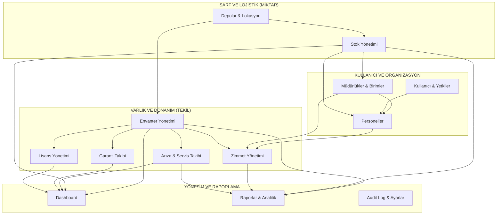

# T.C. BELEDİYE BAŞKANLIĞI
## BİLGİ İŞLEM MÜDÜRLÜĞÜ ENVANTER VE STOK TAKİP SİSTEMİ
### PROFESYONEL SİSTEM ANALİZ VE MİMARİ DOKÜMANI

---

## 1. GİRİŞ VE SİSTEMİN KAPSAMI

Bu sistem, Belediye Bilgi İşlem Müdürlüğü bünyesinde yer alan tüm bilgi teknolojileri (BT) altyapısının, donanımların, sarf malzemelerinin, yazılım lisanslarının ve kurumsal zimmetlerin uçtan uca, izlenebilir, denetlenebilir ve modüler bir yapıda yönetilmesi amacıyla tasarlanmıştır.

### 1.1 Envanter ve Malzeme Katmanları

Belediye bünyesindeki malzemeler iki temel kategoride değerlendirilir:
1. **Tekil Takip Edilen Cihazlar (Envanter / Demirbaş):** Seri numarası, barkod, MAC adresi veya IP adresi ile tekil olarak izlenen ve zimmetlenebilen cihazlar (*Bilgisayar, Laptop, Monitör, Yazıcı, Switch, Access Point, Kamera, UPS, Sunucu vb.*).
2. **Miktar Bazlı Takip Edilen Malzemeler (Sarf Malzemesi / Stok):** Seri numarası takibi gerektirmeyen, adet veya koli bazında depoya girip çıkan sarf malzemeleri (*Toner, Kartuş, Mouse, Klavye, Cat6 Patch Kablo, Patch Panel, Konnektör, Pil vb.*).

---

## 2. MODÜL DETAYLARI VE KULLANICI ETKİLEŞİMLERİ

---

### MODÜL 1: DOKÜMAN & GÖSTERGE PANELİ (DASHBOARD)

#### a) Amacı
Yöneticilere ve Bilgi İşlem personeline belediyenin tüm BT varlıklarının anlık durumunu, kritik stok seviyelerini, arızadaki cihazları ve yaklaşan lisans/garanti sürelerini tek bir ekranda sunmak.

#### b) Kullanıcı İşlemleri ve Senaryolar
- **Yönetici Özeti:** Toplam envanter sayısı, zimmetli cihaz oranı, arızada bekleyen cihaz sayısı, bu ay tüketilen toner/sarf malzeme maliyeti özet grafiklerini izleme.
- **Kritik Uyarı Paneli:** 
  - Stok seviyesi kritik eşiğin altına düşen sarf malzemeleri uyarısı (*örn: A4 Kağıdı < 10 koli, HP Toner < 5 adet*).
  - Garanti süresi 30 gün içinde dolacak cihazların listesi.
  - Yenileme tarihi yaklaşan yazılım lisansları.
- **Hızlı Aksiyonlar:** Doğrudan gösterge panelinden "Yeni Zimmet Oluştur", "Stok Girişi Yap", "Arıza Kaydı Aç" butonlarına erişim.

#### c) Diğer Modüllerle İlişkisi
- **Envanter, Stok, Zimmet, Arıza, Garanti ve Lisans** modüllerinden verileri anlık olarak çekerek özetler ve KPI göstergeleri sunar.

---

### MODÜL 2: ENVANTER YÖNETİMİ (IT ASSET MANAGEMENT)

#### a) Amacı
Belediyeye ait tüm tekil donanımların (PC, Laptop, Monitör, Yazıcı, Switch, Kamera, UPS vb.) teknik özellikleri, seri numaraları, marka/modellere göre kimliklendirip kayıt altına alınması.

#### b) Kullanıcı İşlemleri ve Senaryolar
- **Cihaz Kaydı ve Özellik Tanımlama:**
  - Seri No, Belediye Demirbaş No, Barkod / QR Kod üretimi.
  - Marka, Model, Kategori (Laptop, Sunucu vb.).
  - Teknik Detaylar: CPU, RAM, Disk, MAC Adresi, IP Adresi, İşletim Sistemi.
- **Durum (Status) Yönetimi:**
  - *Boşta / Depoda:* Zimmetlenmeye hazır.
  - *Zimmetli:* Bir personele veya birime atanmış.
  - *Arızada / Serviste:* Tamir sürecinde.
  - *Hurda / Hek:* Kullanım dışı bırakılmış.
- **Barkod / QR Etiket Yazdırma:** Cihaz üzerine yapıştırılmak üzere barkod basımı.

#### c) Diğer Modüllerle İlişkisi
- **Depolar:** Cihazın hangi depoda veya oda/rafta durduğunu belirler.
- **Zimmet Yönetimi:** Cihazın kime veya hangi birime zimmetli olduğunu sağlar.
- **Arıza Takibi:** Arızalanan cihaz bu modüldeki durumunu "Arızada" olarak günceller.
- **Garanti Takibi:** Garanti süresi ve tedarikçi firma bu modülle ilişkilendirilir.

---

### MODÜL 3: STOK YÖNETİMİ (CONSUMABLE & STOCK MANAGEMENT)

#### a) Amacı
Seri numarası takibi yapılmayan, adet/miktar bazlı sarf malzemelerinin (Toner, Klavye, Mouse, Kablo, Konnektör vb.) depolara giriş/çıkış hareketlerini ve miktar takibini sağlamak.

#### b) Kullanıcı İşlemleri ve Senaryolar
- **Stok Kalemi Tanımlama:** Malzeme adı, birimi (Adet, Koli, Metre), kategorisi, minimum stok seviyesi (Reorder Point).
- **Stok Girişi (İrsaliye / Satın Alma):** Depoya giren sarf malzemesini miktar, birim fiyat, fatura/irsaliye no ve tedarikçi seçerek stoğa ekleme.
- **Stok Çıkışı / Sarf Etme:** Bir personele veya birime verilmek üzere stoktan düşme (*örn: Yazı İşleri Müdürlüğü'ne 3 adet siyah toner verildi*).
- **Stok Hareket Geçmişi:** Hangi sarf malzemesi ne zaman, kim tarafından, hangi birime teslim edildi detaylı dökümü.

#### c) Diğer Modüllerle İlişkisi
- **Depolar:** Malzemenin hangi depoda kaç adet bulunduğunu takip eder.
- **Personeller & Müdürlükler:** Sarf malzemenin teslim edildiği kişiyi veya birimi kaydeder.

---

### MODÜL 4: ZİMMET YÖNETİMİ (CUSTODY & ASSIGNMENT MANAGEMENT)

#### a) Amacı
Envanterde bulunan tekil cihazların belediye personeline, müdürlüklere veya ortak alanlara (Toplantı Salonu, Sistem Odası vb.) zimmetlenmesi ve yasal teslim-tesellüm tutanaklarının oluşturulması.

#### b) Kullanıcı İşlemleri ve Senaryolar
- **Zimmet Atama:** Seçilen cihazı/cihazları bir personele zimmetleme (*Örn: Ahmet Yılmaz'a Dell Laptop + Dell Monitör + Klavye-Mouse verilmesi*).
- **Zimmet İade / Devir:** Personel işten ayrıldığında veya cihaz değiştirildiğinde zimmeti depoya iade alma ya da başka bir personele devretme.
- **Zimmet Tutanak Formu (PDF/Çıktı):** Sistem üzerinden otomatik "Zimmet Teslim-Tesellüm Tutanak Formu" üretilmesi, çıktısının alınıp ıslak/elektronik imza ile arşivlenmesi.
- **Kişi Üzerindeki Zimmet Sorgulama:** Bir personelin üzerindeki tüm aktif ve geçmiş zimmetleri listeleme.

#### c) Diğer Modüllerle İlişkisi
- **Envanter:** Cihazın durumunu "Zimmetli" yapar.
- **Personeller & Müdürlükler:** Zimmetin sahibini belirler.
- **Depolar:** İade edilen zimmetli cihaz depoya "Boşta" olarak döner.

---

### MODÜL 5: PERSONEL YÖNETİMİ (STAFF MANAGEMENT)

#### a) Amacı
Belediyede görev yapan tüm personelin (Memur, Sözleşmeli, İşçi, Şirket Elemanı vb.) kimlik, birim, unvan ve iletişim bilgilerinin tutulması.

#### b) Kullanıcı İşlemleri ve Senaryolar
- **Personel Kaydı ve Güncelleme:** T.C. Kimlik No, Ad-Soyad, Kurum Sicil No, E-posta, Telefon, Dahili No.
- **Birim / Unvan Ataması:** Personelin hangi müdürlük ve alt birimde çalıştığı, görevi.
- **Personel Detay Kartı:** Personelin zimmetindeki aktif donanımlar, aldığı sarf malzemeleri ve geçmiş arıza talepleri.
- **İşten Ayrılma / Birim Değişikliği:** Personel pasife çekildiğinde üzerindeki zimmetlerin otomatik uyarı vermesi.

#### c) Diğer Modüllerle İlişkisi
- **Müdürlükler:** Personelin bağlı olduğu birim.
- **Zimmet Yönetimi:** Zimmet sahibi.
- **Kullanıcı ve Yetkilendirme:** Sistemi kullanacak Bilgi İşlem çalışanları personel kartı ile eşleşir.

---

### MODÜL 6: MÜDÜRLÜKLER VE BİRİMLER (DIRECTORATES & LOCATIONS)

#### a) Amacı
Belediye organizasyon şeması, hizmet binaları ve alt birim hiyerarşisinin tanımlanması.

#### b) Kullanıcı İşlemleri ve Senaryolar
- **Müdürlük Hiyerarşisi:** Ana Hizmet Binası -> Bilgi İşlem Müdürlüğü -> Yazılım Birimi.
- **Hizmet Binaları / Lokasyonlar:** Ana Hizmet Binası, Ek Hizmet Binası, Zabıta Amirligi, Kültür Merkezi, Şantiye Binası vb.
- **Birim Bazlı Maliyet ve Envanter Analizi:** Hangi müdürlüğün bünyesinde kaç adet cihaz olduğu ve ne kadar sarf malzeme tükettiği takibi.

#### c) Diğer Modüllerle İlişkisi
- **Personeller:** Personelin görev yeri.
- **Zimmet Yönetimi:** Ortak alan zimmetleri (Müdürlük zimmeti).
- **Raporlar:** Birim bazlı envanter/stok raporları.

---

### MODÜL 7: DEPO VE LOKASYON YÖNETİMİ (WAREHOUSE MANAGEMENT)

#### a) Amacı
Bilgi İşlem Müdürlüğü'ne ait fiziksel depoların, sistem odalarının, raf ve kutu konumlarının yönetilmesi.

#### b) Kullanıcı İşlemleri ve Senaryolar
- **Depo Tanımlama:** 
  - *Merkez Bilgi İşlem Deposu*
  - *Sistem Odası (Sunucu/Ağ Ekipmanı Deposu)*
  - *Hurda / Hek Deposu*
  - *Teknik Servis / Tamir Deposu*
- **Raf / Kutu Konumu (Bin Location):** A-Rafı / 2. Kat / Kutu-12 şeklinde detaylı konumlama.
- **Depolar Arası Transfer:** Malzemenin veya cihazın bir depodan diğer depoya nakledilmesi (*Merkez Depo -> Teknik Servis Deposu*).

#### c) Diğer Modüllerle İlişkisi
- **Envanter & Stok Yönetimi:** Ürünlerin fiziksel nerede durduğunu gösterir.

---

### MODÜL 8: ARIZA VE SERVİS TAKİBİ (FAULT & REPAIR TRACKING)

#### a) Amacı
Arızalanan donanımların arıza bildirimi, iç teknik servis müdahalesi, dış yetkili servis süreçleri ve parça değişimlerinin kaydı.

#### b) Kullanıcı İşlemleri ve Senaryolar
- **Arıza Kaydı Açma:** Arızalanan cihaz seçilerek (Barkod/Seri No) şikayet ve arıza tanımı girilir.
- **Teknik Servis Süreci:**
  - *İç Servis Müdahalesi:* Bilgi İşlem teknisyeni tarafından yapılan onarım ve kullanılan yedek parça (Stoktan düşen RAM/Disk vb.).
  - *Dış Servis / Garanti Gönderimi:* Cihazın yetkili servise (HP, Dell vb.) gönderilmesi, servis takip numarası ve kargo bilgisi.
- **Onarım Tamamlama / Hurdaya Ayırma:** Onarılan cihaz depoya "Boşta" olarak döner; tamir edilemeyen cihaz "Hurda" statüsüne alınır.

#### c) Diğer Modüllerle İlişkisi
- **Envanter:** Cihazın durumunu "Arızada" yapar.
- **Garanti Takibi:** Cihazın garantisi devam ediyorsa yetkili servise yönlendirir.
- **Stok Yönetimi:** Onarımda kullanılan yedek parçaları stoktan düşer.

---

### MODÜL 9: GARANTİ TAKİBİ (WARRANTY MANAGEMENT)

#### a) Amacı
Satın alınan cihazların garanti süreleri, tedarikçi/yüklenici firmalar ve bakım anlaşmalarının takibi.

#### b) Kullanıcı İşlemleri ve Senaryolar
- **Garanti ve Tedarikçi Tanımlama:** Satın alma tarihi, garanti başlangıç/bitiş tarihi, tedarikçi firma adı, sözleşme no.
- **Garanti Süresi Uyarısı:** Garantisinin bitmesine 60, 30 ve 15 gün kalan cihazların listelenmesi ve otomatik e-posta uyarısı.
- **Firma Bazlı Performans:** Hangi tedarikçiden alınan ürünlerde ne kadar arıza yaşandığı analizi.

#### c) Diğer Modüllerle İlişkisi
- **Envanter:** Cihaz kartında garanti bitiş tarihini gösterir.
- **Arıza Takibi:** Arızalanan cihazın garantisinin devam edip etmediğini kontrol eder.

---

### MODÜL 10: LİSANS YÖNETİMİ (SOFTWARE LICENSE MANAGEMENT)

#### a) Amacı
Belediye bünyesinde kullanılan işletim sistemleri, ofis yazılımları, CAD/GIS çizim programları, antivirüs ve özel belediye yazılımlarının lisans takibi.

#### b) Kullanıcı İşlemleri ve Senaryolar
- **Lisans Kaydı:** Yazılım adı, lisans anahtarı (Product Key), lisans tipi (OEM, Volume License, Abonelik/SaaS).
- **Lisans Adet & Kullanım Takibi:** Toplam satın alınan lisans sayısı vs. aktif cihazlara atanmış lisans sayısı (Boştaki lisanslar).
- **Cihaz / Personel Eşleştirmesi:** Hangi lisansın hangi bilgisayara (IP/Host Name) kurulduğunun kaydı.
- **Abonelik Yenileme Uyarısı:** Yıllık yenilenen lisansların (Adobe, Antivirüs vb.) bitiş tarihi uyarıları.

#### c) Diğer Modüllerle İlişkisi
- **Envanter:** Lisansın yüklü olduğu bilgisayar/sunucu ile eşleşir.

---

### MODÜL 11: RAPORLAR VE ANALİTİK (REPORTS & ANALYTICS)

#### a) Amacı
Yönetimsel kararlar, Sayıştay denetimleri ve bütçe planlamaları için esnek, filtrelenebilir ve dışa aktarılabilir (PDF, Excel) raporlar sunmak.

#### b) Kullanıcı İşlemleri ve Senaryolar
- **Birim Bazlı Envanter Raporu:** Hangi müdürlükte kaç adet PC, Laptop, Yazıcı var dökümü.
- **Sarf Malzeme Tektip / Maliyet Raporu:** Tarih aralığına göre hangi müdürlük ne kadar toner/kağıt tüketti.
- **Zimmet Tutanak Raporları:** Kişi veya birim bazlı zimmet listeleri.
- **Kronik Arıza Raporu:** En çok arızalanan marka/model ve cihazların listesi.
- **Garanti & Lisans Süre Sonu Raporları.**

#### c) Diğer Modüllerle İlişkisi
- Tüm modüllerden veri okuyarak çalışır.

---

### MODÜL 12: KULLANICI VE YETKİLENDİRME (USERS & ROLES - RBAC)

#### a) Amacı
Sistemi kullanacak personelin rol ve yetki sınırlarının belirlenmesi.

#### b) Kullanıcı İşlemleri ve Senaryolar
- **Kullanıcı Hesabı Oluşturma:** Personel kartı ile ilişkilendirilmiş kullanıcı adı, e-posta, şifre.
- **Rol Matrisi (Role-Based Access Control):**
  - *Sistem Yöneticisi (Super Admin):* Tüm yetkilere sahip.
  - *Depo & Stok Sorumlusu:* Stok girişi/çıkışı yapabilir, envanter düzenleyebilir.
  - *Teknik Servis Elemanı:* Arıza kayıtlarını yönetebilir, cihaz durumunu değiştirebilir.
  - *Birim Sorumlusu (Departman Yetkilisi):* Sadece kendi biriminin zimmetlerini ve taleplerini görebilir.
  - *Auditor / Salt Okunur:* Sadece raporları izleyebilir.

#### c) Diğer Modüllerle İlişkisi
- **Personeller:** Kullanıcının personel kimliği.
- **Sistem Ayarları:** Loglama ve güvenlik.

---

### MODÜL 13: SİSTEM AYARLARI VE İŞLEM GEÇMİŞİ (AUDIT LOG & SETTINGS)

#### a) Amacı
Sistem parametreleri, sözlük verileri (Marka, Model, Kategori) ve yapılan tüm kritik işlemlerin denetim loglarının (Audit Trail) tutulması.

#### b) Kullanıcı İşlemleri ve Senaryolar
- **Parametre Tanımları:** Kategori ekleme/silme, Marka/Model tanımları, Depo tipleri.
- **E-Posta / Bildirim Ayarları:** SMTP sunucu ayarları, otomatik uyarı mail şablonları.
- **Audit Log (İşlem İzleme):** Kim, Ne Zaman, Hangi IP'den, Hangi İşlemi Yaptı? (Örn: *Ahmet Yılmaz, 07.08.2026 14:15'te ENV-2026-089 ID'li cihazın zimmetini değiştirdi. Eski Değer: Fen İşleri, Yeni Değer: İmar Mük.*).

#### c) Diğer Modüllerle İlişkisi
- Tüm sistem hareketlerini arka planda kaydeder.

---

## 3. MODÜLLER ARASI VERİ AKIŞ VE İLİŞKİ ŞEMASI

---

## 4. BELEDİYE BİLGİ İŞLEM SÜREÇ ÖRNEKLERİ (USE CASE)

### Senaryo 1: Yeni Bilgisayar Satın Alındı ve Personele Verildi
1. **Fatura/İrsaliye Gelir:** Cihaz **[Envanter Modülü]** üzerinden Seri No ve Demirbaş No ile "Boşta" statüsünde **Merkez Depo**'ya kaydedilir.
2. **Garanti Tanımlanır:** Garanti başlangıç/bitiş tarihi **[Garanti Modülü]** altına işlenir.
3. **Lisans Atanır:** Bilgisayara Windows ve Office lisansı **[Lisans Modülü]** üzerinden bağlanır.
4. **Zimmetlenir:** Cihaz **[Zimmet Modülü]** üzerinden Yazı İşleri personeline atanır, cihazın durumu "Zimmetli" olur, sistemden **Zimmet Tutanak Formu (PDF)** çıktısı alınır.

### Senaryo 2: Yazıcı Toneri Bitti ve Talep Edildi
1. **Stok Girişi:** Satın alınan 50 adet HP Toner **[Stok Modülü]** üzerinden Merkez Depo'ya eklenir.
2. **Stok Çıkışı:** İmar Müdürlüğü personeli depoya gelip toner talep ettiğinde, görevli **[Stok Modülü]** üzerinden 1 adet toner çıkışı yapar (İmar Müdürlüğü seçilir).
3. **Kritik Eşik:** Depodaki toner sayısı 5'in altına düştüğünde **[Dashboard]** ekranına ve yetkiliye otomatik "Kritik Stok Uyarısı" düşer.

---

## 5. SONUÇ VE SONRAKİ ADIMLAR

Bu analiz dokümanı, Belediye Bilgi İşlem Müdürlüğü'nün tüm operasyonel ihtiyaçlarını karşılayacak esneklikte hazırlanmıştır.
